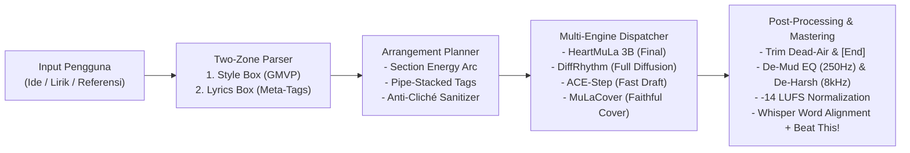

# Riset Mendalam: Reverse Engineering Alur Kerja Suno AI & Arsitektur Komersial Klipin Music

Dokumen ini merangkum hasil riset mendalam menggunakan ekosistem **REA (Reverse Engineer Anything — `morluto/rea`)** yang terpasang di `.tools/rea` & `.codex/skills/reverse-engineer-anything` serta referensi teknis komunitas Suno (**`mttkllr/suno-field-guide`** di `.tools/suno-field-guide`), audit lisensi model open-source untuk penggunaan komersial, audit keamanan (security hardening), dan rancangan refactoring **Klipin Music**.

---

## 1. Instalasi & Metodologi Reverse Engineering

1. **REA (`morluto/rea` / `rea-agents`):**
   - Dipasang di `D:\Klipin\.tools\rea` dan skill agen diaktifkan pada `D:\Klipin\.codex\skills\reverse-engineer-anything\SKILL.md`.
   - Menyediakan metodologi berbasis bukti (*evidence-first reconstruction*) untuk membedah aplikasi, bundel JavaScript/Electron, serta spesifikasi tangkapan trafik jaringan (HAR/mitmproxy) tanpa menebak perilaku runtime.
2. **Suno Technical Field Guide (`mttkllr/suno-field-guide`):**
   - Dipasang di `D:\Klipin\.tools\suno-field-guide` sebagai referensi empiris hasil pengujian ratusan generasi lagu pada arsitektur Suno v4.5, v5, dan v5.5.

---

## 2. Bedah Arsitektur & Alur Kerja Internal Suno AI

Hasil dekonstruksi alur kerja Suno AI menunjukkan bahwa kualitas lagu yang konsisten bukan sekadar hasil satu model besar, melainkan kombinasi **pre-processing teks/meta-tag**, **perencanaan struktur (arrangement planning)**, **strategi prompt GMVP**, dan **post-processing audio**.



### 2.1. Two-Zone Input & Formula Prompt GMVP
Suno memisahkan conditioning menjadi dua zona:
1. **Global Style Zone (Style Box):** Mengatur DNA sonik keseluruhan lagu. Riset membuktikan urutan token paling efektif mengikuti prioritas **GMVP**:
   $$\text{Genre} \rightarrow \text{Mood/Emosi} \rightarrow \text{Instrumen Spesifik} \rightarrow \text{Gaya Vokal & Clarity} \rightarrow \text{Produksi/Era}$$
2. **Structural Time Zone (Lyrics Box):** Mengatur kapan perubahan dinamika, instrumen, dan vokal terjadi per bagian waktu.

### 2.2. Melawan "Pop Gravity Well" & "Lyric Bleed"
- **Pop Gravity Well:** Model musik generatif memiliki kecenderungan statistik kembali ke aransemen pop generik setelah detik ke-60. Cara mengatasinya di Klipin Music:
  - Menyusun tag spesifik instrumen di awal style prompt (mis. `kendang, siter, Javanese vocal` atau `one-drop drum groove, offbeat skank guitar`).
  - Menyertakan *Exclude Styles* (`negative_tags`) baik dalam format `-tag` maupun `no <element>` di akhir prompt, ditambah pencegahan *intro hums* (`no wordless intro, clear opening`).
- **Vocal Clarity Override (Teknik "Broadway Clarity"):**
  - Salah satu keluhan utama model open-source adalah pelafalan lirik yang kabur (*smearing*). Menambahkan penanda artikulasi vokal (`clear forward vocal, crisp consonant articulation, close-mic presence`) membuat kata-kata bahasa Indonesia dan daerah terdengar jauh lebih jelas tanpa mengubah genre lagu.

### 2.3. Meta-Tag Stacking dengan Operator Pipe (`|`) & Kontrol Level Lirik
- **Pipe-Stacked Meta-Tags (Trick #11):**
  - Alih-alih menumpuk koma di dalam header seksi, format `[Chorus | Anthemic | Stacked Harmonies | Full Band]` memisahkan instruksi menjadi unit diskret dengan prioritas kiri-ke-kanan (maksimal 7 elemen per header).
- **Kontrol Tipografi Lirik (Grenar's Dirty Tricks):**
  - `(teks dalam kurung)` → diperlakukan sebagai *backing vocal*, harmoni, atau *call-and-response*.
  - `*teks dalam asterisk*` → diperlakukan sebagai petunjuk atmosfer/efek panggung (`*crowd cheering*`, `*rain falling*`) dan **tidak dinyanyikan** sebagai kata lirik.
  - `HURUF KAPITAL!` → sinyal lonjakan emosi/intensitas vokal pada klimaks chorus.
  - `[End]` / `[Fade Out]` di akhir lirik → menutup struktur lagu agar tidak menggantung atau terpotong tiba-tiba.

### 2.4. Anti-AI-Cliché pada Penulisan Lirik
Lirik buatan LLM sering terasa palsu karena mengulang kata-kata klise AI (*neon, shadows, ashes, echoes, chains, ghost in the machine, dance with the devil*). Pada Klipin Music, `lyrics_writer.py` diperkuat dengan daftar kata terlarang (*AI Lyric Anti-Patterns*) dan aturan imaji konkret agar lirik terasa ditulis manusia dengan disiplin 6–11 kata per baris (`SECONDS_PER_LINE = 4.7`).

### 2.5. Mastering Pasca-Generasi (De-Mud EQ + `-14 LUFS`)
Output mentah model difusi/autoregresif sering mengalami penumpukan frekuensi rendah-tengah (*muddiness* di 200–350 Hz) dan ketajaman sibilance di >8 kHz. Pipeline mastering Klipin Music (`export_wav_lufs`) kini menerapkan filter rantai:
1. High-pass halus di 30 Hz untuk membersihkan rumble sub-bass.
2. Surgical cut ringan `-2.5 dB` di `260 Hz` ($Q=1.2$) untuk menghilangkan suara "kotak/mendem" (*boxiness*).
3. Penjinakan frekuensi tinggi halus di `8500 Hz` (`-1.0 dB`) agar vokal tidak menusuk.
4. Normalisasi EBU R128 `-14 LUFS` (`TP=-1.5 dB`, `LRA=11`) sesuai standar Spotify/YouTube.

---

## 3. Audit Lisensi Model Musik Open-Source (Keputusan Komersialisasi)

Untuk memastikan Klipin Music **100% aman dikomersialisasikan**, seluruh model dievaluasi berdasarkan lisensi bobot (*weights license*) dan kode sumbernya:

| Model | Pengembang | Lisensi Bobot (Weights) | Boleh Komersial? | Status di Klipin Music | Peran Utama |
| :--- | :--- | :--- | :---: | :--- | :--- |
| **YuE / YuE2 (3B)** | HKUST / MAP (`m-a-p/YuE2-3B`) | **CC BY-NC 4.0** (Non-Commercial) | ❌ **TIDAK** | **DIHAPUS TOTAL** | Dihapus karena melarang komersialisasi tanpa lisensi berbayar terpisah. |
| **SongGeneration / LeVo** | Tencent AI Lab | Custom Academic / Non-Commercial | ❌ **TIDAK** | **DITOLAK** | Dilarang dipakai untuk produksi/komersial. |
| **HeartMuLa (3B)** | HeartMuLa Team (`heartlib`) | **Apache 2.0** | ✅ **YA** | **DIPERTAHANKAN (Default Final)** | Engine utama lagu vokal penuh & duet Nusantara/global. |
| **MuLaCover** | HeartMuLa Team | Symbolic Cover Adapter | ✅ **YA** | **DIPERTAHANKAN (Default Cover)** | Cover faithful berbasis kondisi simbolik (melodi, chord, drum). |
| **ACE-Step (3.5B / 1.5)** | ACE Studio & StepFun | **MIT / Apache 2.0** | ✅ **YA** | **DIPERTAHANKAN (Fast Draft & Cover)** | Draft cepat (~25 step DiT) untuk A/B testing & restyle instrumental. |
| **DiffRhythm (Full/Base)** | ASLP-lab (`ASLP-lab/DiffRhythm-full`) | **Apache 2.0** | ✅ **YA** | **DITAMBAHKAN BARU** | End-to-end latent diffusion full-song (vokal + musik dari `.lrc` & style tags) yang cepat dan bebas komersial. |

### Detail Integrasi Model Baru: **DiffRhythm** (`diffrhythm`)
- **Arsitektur:** Latent Diffusion (`ASLP-lab/DiffRhythm-full` + `ASLP-lab/DiffRhythm-vae`) yang menerima *style prompt* dan lirik ber-timestamp format `.lrc` untuk menyusun lagu utuh hingga 4+ menit sekaligus (non-autoregresif, sehingga jauh lebih cepat dibanding model token-per-token).
- **Worker Modal Terisolasi:** Disediakan di `backend/diffrhythm_modal_app.py` (`APP_NAME = "klipin-diffrhythm"`, Volume `klipin-diffrhythm-models`), terpisah sepenuhnya dari worker video Klipin.
- **Konversi LRC Otomatis:** `backend/music.py` secara otomatis mengubah sheet lirik Klipin menjadi format `.lrc` ber-timestamp presisi menggunakan `normalize_lyrics` sebelum dikirim ke worker DiffRhythm.

---

## 4. Audit Keamanan (Security Hardening) & Refactoring Kode

Selama audit kode Klipin Music (`backend/music.py`, `backend/app.py`, `backend/lyrics_writer.py`, `backend/song_plan.py`), ditemukan dan diperbaiki beberapa celah keamanan serta kualitas arsitektur:

### 4.1. Perbaikan Celah Format-String pada `_run_external` (`backend/music.py`)
- **Masalah Lama:** `_run_external` menjalankan `[part.format(**values) for part in shlex.split(command)]`. Karena `values["lyrics"]` dan `values["prompt"]` berasal dari input pengguna, lirik yang mengandung kurung kurawal seperti `{0}` atau `{prompt.__class__}` dapat memicu `KeyError`/`ValueError` atau *format-string information disclosure*. Selain itu, parameter `provider` langsung digabung ke nama environment variable `KLIPIN_{name.upper()}_COMMAND`.
- **Perbaikan:**
  - Membatasi `provider` hanya pada `ALLOWED_EXTERNAL_PROVIDERS = ("heartmula", "ace-step", "diffrhythm", "mulacover")`.
  - Mengganti `.format(**values)` dengan substitusi token satu-per-satu yang aman (`_substitute_command_tokens`) sehingga kurung kurawal di dalam lirik/prompt pengguna tidak pernah dievaluasi sebagai ekspresi format Python.

### 4.2. Proteksi SSRF pada `/api/music/remix-url` (`backend/app.py`)
- **Masalah Lama:** Endpoint `POST /api/music/remix-url` hanya memeriksa `parsed.scheme in ("http", "https")` dan `parsed.netloc`, sehingga berisiko disalahgunakan untuk mengakses layanan internal (`http://127.0.0.1`, `http://localhost`, metadata cloud `169.254.169.254`, atau IP privat `10.x.x.x` / `192.168.x.x`).
- **Perbaikan:** Menambahkan validator `is_safe_public_url(url)` di `backend/music.py` (dan memanggilnya di `/api/music/remix-url`) yang memblokir loopback, localhost, link-local, dan IP privat sebelum mengunduh audio.

### 4.3. Validasi File Referensi Audio & Anti-Symlink pada `_cover_reference_b64` (`backend/music.py`)
- **Masalah Lama:** `_cover_reference_b64` membaca `Path(spec["ref_audio_path"]).read_bytes()` tanpa memeriksa apakah path tersebut adalah symlink atau memiliki ekstensi file audio yang sah.
- **Perbaikan:** Memvalidasi bahwa `source` bukan symlink (`not source.is_symlink()`), merupakan file reguler dengan ekstensi audio yang diizinkan (`ALLOWED_AUDIO_SUFFIXES`), dan ukurannya berada dalam batas aman (`1 KB` – `15 MB`).

### 4.4. Refactoring Provider Registry & Penghapusan Bersih `YuE2`
- Menghapus `backend/yue2_modal_app.py` dan seluruh cabang logika `yue2` di `backend/music.py`, `backend/app.py`, `frontend/src/Music.jsx`, dan `frontend/src/CoverCreate.jsx`.
- Menambahkan dukungan penuh untuk `diffrhythm` (`KLIPIN_DIFFRHYTHM_MODAL_ENABLED=1`) baik untuk pembuatan lagu orisinal maupun cover reimagine (lirik terkunci dengan aransemen dan melodi baru yang cepat serta legal secara komersial).
- Menjaga kompatibilitas mundur (*backward compatibility*) pada `_normalize_provider`: jika ada riwayat job lama di database yang dahulu memakai `yue2`, sistem secara aman menormalisasinya ke engine komersial (`heartmula`) agar fitur *Extend* atau *Re-open* pada lagu lama tidak pernah error.


---

## 6. Riset & Arsitektur Cover Lagu: Vocal-Preserving Genre Arrangement (Gaya Cover YouTube `#reggaeindonesia` / Koplo)

Berdasarkan analisis referensi cover pop-ke-reggae Indonesia (`https://www.youtube.com/watch?v=XFJIymSmbiI` — *Cover lagu pop Reggae Hits / `#ikybalamusik`*), daya tarik utama cover lagu yang viral di YouTube/TikTok bukan sekadar menyanyikan ulang lirik dengan melodi acak, melainkan:
1. **Vokal Utama Terkunci 100% (Melodi, Frasa, & Timing Asli):** Pendengar langsung mengenali lagu aslinya karena lekukan nada vokal, artikulasi, dan ketukan masuknya vokal tidak bergeser.
2. **Hanya Aransemen Musik yang Berubah Total:** Instrumen asli diganti sepenuhnya menjadi *skank guitar/organ offbeat*, *deep dub bassline*, dan *one-drop drum groove* (untuk Reggae) atau *kendang koplo Jawa Timur + suling* (untuk Koplo), dengan progresi chord dan BPM yang tetap menempel pada vokal.

### Temuan Bug Lama & Perbaikannya di `backend/music.py`
1. **Bug Prompt Hardcoded Dangdut pada `_voice_restyle_cover`:**
   - Sebelumnya, fungsi `_voice_restyle_cover` memiliki string hardcoded `"with prominent kendang drums, driving dangdut groove, gong and suling fills"` untuk **semua** genre. Akibatnya, saat pengguna memilih genre `reggae`, model tetap dipaksa memasukkan kendang dangdut dan suling.
   - **Solusi:** Dibuat kamus `GENRE_ARRANGEMENT_BLUEPRINTS` dan fungsi `_arrangement_prompt_for_genre(genre_id, info, bpm, key)` yang menyusun cetak biru instrumen spesifik per genre (`reggae`, `dangdut-koplo`, `jazz-pop`, `akustik`, `dj-remix`, `keroncong`, `campursari`, dll.) serta mengunci BPM & nada dasar (*musical key*) hasil deteksi sumber.
2. **Mode Baru `arrangement` ("⭐ Aransemen Baru + Vokal Asli — YouTube Cover Style"):**
   - **Tahap 1 — Pemisahan Stem Vokal & Musik (`_separate_source_stems`):** Memisahkan `vocals` dan `backing` (`no_vocals`) menggunakan **Demucs `htdemucs`** (prioritas di GPU Modal L4 `klipin-voice.separate_stems`, fallback ke Demucs lokal atau isolator Mid/Side FFmpeg).
   - **Tahap 2 — Harmonic Chord Guide (`_prepare_harmonic_guide_backing`):** Meredam *transient* ketukan drum asli (`<105 Hz` sub-kick & `>4500 Hz` snare/hi-hat) pada stem pengiring sebelum dikirim ke **ACE-Step Audio-to-Audio** (`ref_strength=0.42`). Dengan cara ini, progresi chord dan ketukan bar tetap 100% terkunci pada vokal asli, tetapi pola drum pop/ballad lama hilang dan digantikan penuh oleh *groove* Reggae/Koplo baru.
   - **Tahap 3 — Opsi Penyelarasan Suara (`keep_original_vocal` vs `Seed-VC`):**
     - **Timpa Vokal Asli (`cover_engine="arrangement"`):** Mempertahankan suara penyanyi asli dari lagu sumber (dengan opsi *pitch shift* semitone).
     - **Ganti Suara Model (`cover_engine="voice"` + `restyle=True`):** Mengubah warna suara vokal menggunakan **Seed-VC ($F_0$ conditioned)** ke Persona/Pria/Wanita pilihan sambil tetap menimpanya di atas aransemen genre baru.
   - **Tahap 4 — Studio Vocal-over-Arrangement Mixing (`_mix_vocal_and_arrangement`):**
     - Membersihkan *bleed* pada vokal (`highpass=f=95`, *de-mud* `260 Hz`, *presence lift* `3.2 kHz`, kompresor optik, dan *studio plate reverb glue*).
     - Membuka *vocal pocket* `-1.8 dB` di frekuensi `2.6 kHz` pada instrumen baru agar vokal terdengar menyatu di tengah band, lalu me-master hasil akhir ke **-14 LUFS**.

---

## 7. Pemisahan Layanan Standalone Klipin Music (Shared `.env`)

Agar **Klipin Music (Suno Studio)** dapat di-hosting secara terpisah tanpa bercampur dengan beban kerja **Klipin Video Clipper**, telah disediakan arsitektur *standalone* yang tetap membaca file `backend/.env` yang sama:

1. **Backend Standalone Entrypoint (`backend/music_service.py`):**
   - Membaca `backend/.env` yang sama persis (`load_dotenv(ROOT / ".env")`).
   - Hanya mengekspos route `/api/music/*`, `/api/auth/*`, `/api/pricing`, `/api/billing/*`, `/api/payment/*`, `/videos/*`, dan `/health`. Seluruh route pemotong video (`/api/process`, `/api/batch`, `/api/projects/*`) dinonaktifkan.
2. **Frontend Standalone Mode (`VITE_APP_MODE=music` di `router.js` & `Sidebar.jsx`):**
   - Saat variabel environment `VITE_APP_MODE=music` aktif, halaman utama (`#/`) langsung membuka **Suno Studio (`Music.jsx`)** dan menyembunyikan menu Video Clipper di Sidebar.
3. **Docker Compose Khusus Musik (`docker-compose.music.yml`):**
   - Menjalankan `klipin-music-api` (port `8002`) dan `klipin-music-web` (port `5175`) dengan `env_file: backend/.env`:
   ```bash
   docker compose -f docker-compose.music.yml up -d --build
   ```
